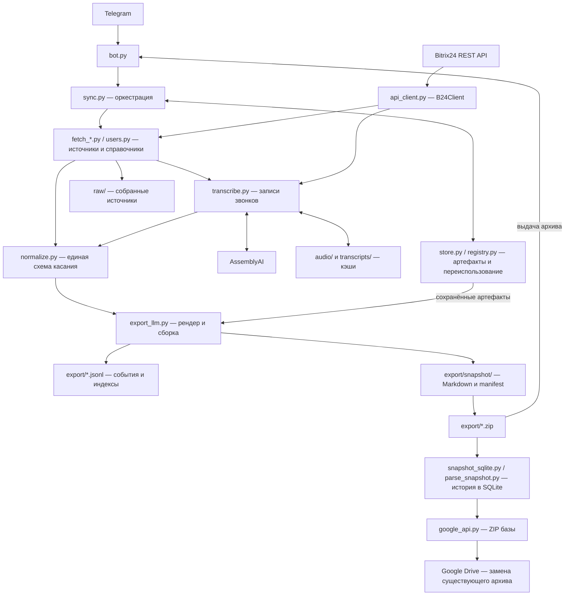

# Bitrix Export — CRM Data Pipeline for AI Analytics

Bitrix Export собирает историю взаимодействий с клиентами из Bitrix24 и
подготавливает структурированные данные для AI-аналитики. Звонки, переписки,
задачи и изменения стадий объединяются в хронологические карточки сделок и лидов,
чтобы анализировать путь клиента и работу сотрудников без ручного сбора сведений
из разных разделов CRM. Результаты можно использовать как контекст для ИИ,
источник для аналитики и баз знаний; сам проект выполняет сбор и подготовку данных.

## Пример результата

Сокращённый фрагмент Markdown-карточки в формате
[`export_llm.deal_markdown`](export_llm.py). Все значения, имена, ID и адрес
полностью синтетические; подписи и порядок строк соответствуют рендеру:

```markdown
# Сделка #900001: Демонстрационный заказ

**CRM:** https://crm.example.invalid/crm/deal/details/900001/

- Ответственный: Алексей Примеров
- Клиент: Мария Демонстрационная
- Текущая стадия: Подготовка предложения
- Источник: Сайт
- Страна: RB
- Создана: 2026-01-15T09:00:00+03:00
- Сумма: 1500.00 BYN

## Лента касаний

[2026-01-15 09:10] 📞 Звонок (входящий, 2:05) — Ирина Образцова [стадия: Новая] | запись: file_id 990001
Транскрипция:
  Клиент уточнил сроки поставки. Договорились подготовить предложение.

[2026-01-15 10:00] 📌 Стадия: Новая → Подготовка предложения
```

Участник звонка и ответственный за сделку здесь различаются. Полная карточка
содержит доступную ленту касаний и дополнительные непустые поля CRM.
[Форматы результатов и схема касания](docs/data.md).

## Основные возможности

- Сбор данных сделок и лидов с разделением на активные, завершённые и технические
  сущности; дубли и тестовые записи выделяются отдельно от проигранных продаж.
- История звонков, переписок открытых линий, задач, комментариев и стадий;
  письма и встречи подключаются настройками.
- Транскрибация записей звонков через AssemblyAI с переиспользованием сохранённых текстов.
- Нормализация разнородных событий: время, канал, фактический участник,
  ответственный и стадия на момент касания.
- Полная и инкрементальная выгрузка с использованием сохранённых артефактов.
- Markdown-карточки, JSONL событий и индексов, ZIP снимка и SQLite.
  **JSONL хранится отдельно от ZIP**; архив содержит карточки и `manifest.json`.
- История снимков в ZIP и накопительной SQLite-базе с версиями карточек и событий.
- Архивирование накопительной SQLite и замена существующего ZIP на Google Drive.
- Управление через Telegram: запуск выгрузки, отображение прогресса и получение ZIP.

## Архитектура

`sync.py` управляет выборкой, сбором источников, нормализацией и сохранением
результатов. Общий поток параметризован для сделок и лидов. Диаграмма показывает
основной экспорт; служебные команды описаны в [архитектуре](docs/architecture.md).



SQLite пополняется после создания ZIP, если включён импорт. Отдельные утилиты
также позволяют импортировать старые ZIP и построить SQLite из JSON/JSONL.
[Схемы SQLite и границы восстановления](docs/data.md#sqlite).

После обновления базы создаётся `export/database/sqlite3_snapshots.zip` и заменяется
одноимённый файл в настроенной папке Google Drive. Подключение использует
сервисный аккаунт из `key.json`; [настройка доступа](docs/setup.md#google-drive).
Базу можно [отправить отдельно](docs/setup.md#разовая-отправка-без-выгрузки-bitrix24)
с консольным прогрессом без запуска выгрузки Bitrix24.

## Инженерные решения

| Решение | Назначение и обоснование |
|---|---|
| Единая схема событий — `normalize.py` | Приводит звонки, сообщения, задачи и стадии к общей форме, отделяя особенности источников от рендера и последующей аналитики. |
| Инкрементальный экспорт — `sync.py`, `fetch_deals.py`, `fetch_leads.py` | Собирает активные и изменённые сущности с перекрытием окна; повторяет ID с ошибками прошлого запуска. Сокращает повторную обработку относительно полной выборки. |
| Переиспользование артефактов — `store.py`, `registry.py` | Переносит закрытые и технические карточки по политике обновления, при совместимой версии схемы и наличии четырёх файлов store. Позволяет сохранять накопленный состав инкрементального снимка. |
| Кэш транскрипций — `transcribe.py` | При наличии сохранённого текста возвращает его без нового распознавания, сокращая повторные сетевые операции и расходы AssemblyAI. |
| Версии в SQLite — `snapshot_sqlite.py` | Переиспользует неизменные поля, события и ленты между снимками, сохраняя их состав и порядок. Перед фиксацией импорта восстанавливает карточки из БД и побайтно сравнивает с ZIP. |
| Пагинация и временные сбои — `api_client.py`, `fetch_openlines.py` | Обходит страницы списков и истории сессий; использует тайм-ауты, паузы и ограниченные повторы с экспоненциальной задержкой для сетевых ошибок и лимитов API. Незавершённую загрузку истории сессии отмечает ошибкой сущности. |
| Участник и ответственный — `normalize.py` | Хранит `actor` отдельно от `responsible_user_id`, чтобы касание относилось к фактическому участнику, а назначение ответственного не искажало аналитику. |
| Workspace lock — `workspace_lock.py` | Общая файловая блокировка отклоняет одновременную запись основного экспорта и обновления переписок в одно рабочее пространство. |
| Manifest и проверка состава — `export_llm.py`, `snapshot_sqlite.py` | Фиксирует фильтры, охват, количества, ID и зарегистрированные ошибки; импорт SQLite сверяет состав карточек с manifest. Это позволяет оценивать результат и выявлять несогласованность артефактов. |
| Резервирование и откат переписок — `chat_refresh.py` | Отделяет подготовку изменений от применения, проверяет SHA-256, создаёт резервные копии и журнал. Позволяет обновлять сохранённые чаты с возможностью отката. |
| Профилирование — `performance.py` | Измеряет длительности этапов, HTTP-запросов, пауз и транскрибации монотонными часами; выводит агрегаты в Loguru для поиска узких мест. |
| Изолированные проверки — `tests/` | Использует unittest, временные каталоги, подмену config и моки внешних сервисов; проверяет экспорт и обслуживание без рабочих секретов и данных. |

Подробности: [режимы и переиспользование](docs/architecture.md#режимы-и-переиспользование),
[обновление переписок](docs/operations.md#обновление-сохранённых-переписок),
[профилирование](docs/operations.md#время-выгрузки-и-запросов).
Сведения о [логах](docs/operations.md#логирование),
[диагностике аудио](docs/operations.md#диагностика-скачивания-аудио) и
[обслуживании сохранённых данных](docs/operations.md#обслуживание) —
в эксплуатационной инструкции.

## Технологический стек

| Категория | Технологии и роль |
|---|---|
| Язык и стандартная библиотека | Python 3.12; SQLite через `sqlite3`, unittest для тестов |
| Библиотеки приложения | Requests — HTTP; aiogram — Telegram-бот; Loguru — логирование; python-dotenv — загрузка настроек окружения; Google API Python Client, google-auth и httplib2 — авторизация и загрузка на Drive |
| Внешние сервисы | Bitrix24 — источник CRM-данных; AssemblyAI — распознавание речи; Telegram — управление и доставка архива; Google Drive — хранение архива SQLite |
| Инструменты разработки | mise — версии Python/uv и задачи; uv — зависимости и `.venv`; Ruff — линтинг и проверка форматирования |

Зависимости объявлены в [pyproject.toml](pyproject.toml), версии зафиксированы
в [uv.lock](uv.lock); версии инструментов и команды — в [mise.toml](mise.toml).

## Быстрый старт

Нужны установленный [mise](https://mise.jdx.dev/getting-started.html), доступ
к Bitrix24 через входящий вебхук, Telegram-бот и разрешённый чат.
Для транскрибации нужен ключ AssemblyAI. Из корня проекта:

```text
mise trust
mise install
mise run setup
```

Настройте `.env`, доступы и параметры [по подробной инструкции](docs/setup.md),
затем запустите бота:

```text
mise run start
```

В разрешённом Telegram-чате отправьте `/start` и нажмите «▶️ Запустить выгрузку».
Бот запускает `sync.py` без аргументов, показывает прогресс и отправляет
созданный ZIP. Параметры выборки и источников задаются в [config.py](config.py).
Перед использованием результата проверьте
[manifest и логи](docs/operations.md#проверка-результата).
Для включённой по умолчанию отправки SQLite на Google Drive настройте
`key.json` и доступ редактора к папке и существующему архиву по
[инструкции](docs/setup.md#google-drive).

Для отдельного тестового Telegram-бота предусмотрены
[.env.dev.example](.env.dev.example) и `mise run start-dev`.
Этот режим меняет реквизиты бота, но использует общие рабочие каталоги и может
обращаться к тем же Bitrix24 и AssemblyAI.
[Приоритет настроек и границы изоляции](docs/setup.md#локальный-тестовый-telegram-бот).

## Тестирование и проверки

После настройки окружения:

```text
mise run test
mise run lint
mise run format-check
```

Тесты используют синтетические данные и моки API. Проверяются полная и
инкрементальная сборка, переиспользование, история открытых линий, обновление
переписок с откатом, SQLite-импорт, управление ботом и диагностика аудио.
Ruff проверяет код и форматирование без исправлений.
[Сценарии, изоляция и запуск без синхронизации окружения](docs/testing.md).

## Состояние и существенные ограничения

Реализован конвейер сбора и подготовки данных с Telegram-интерфейсом,
локальными артефактами и историей снимков. CI не настроен; проверки запускаются
локально. Batch-запросы и очередь транскрибации с ограниченной параллельностью
остаются в [плане доработок](docs/roadmap.md).

- **Полнота зависит от источников.** Права пользователя вебхука, тариф Bitrix24,
  доступность записей, фильтры и ошибки API ограничивают доступную историю.
  Открытые линии требуют прав на отчёты и подходящего тарифа.
- **Режим определяет состав и свежесть.** `full` формирует состав по текущей
  выборке; `incremental` добавляет пригодные сохранённые закрытые и технические
  сущности из store/registry. Оба архива содержат карточки целиком, а не дельту.
  При текущем `REEXPORT_CLOSED_ON_CHANGE=False` закрытые карточки могут
  переноситься без обновления даже после изменения в CRM.
- **Возможна частичная выгрузка.** Зарегистрированные ошибки сущностей дают
  `status=partial`; `is_complete=true` означает отсутствие зарегистрированных
  ошибок, а не гарантированный охват всей CRM. Проверяйте также фильтры,
  пропуски, охват и логи: некоторые ошибки источников перехватываются отдельно.
- **Снимок собирается последовательно.** Это не атомарный снимок живого портала
  и не единая транзакция всех локальных файлов. После обрыва нужна
  [проверка согласованности и сохранности данных](docs/operations.md#хранение-и-безопасность).
- **Рабочий запуск имеет побочные эффекты.** Выгрузка, включая запуск с ID или
  лимитами, делает реальные API-запросы и пишет данные. Распознавание AssemblyAI
  может быть платным; `start-dev` не заменяет изолированные тесты.
- **Результаты конфиденциальны.** Карточки, JSONL, базы, аудио, транскрипции и
  логи могут содержать клиентские данные. Ограничивайте хранение и доступ;
  учитывайте передачу записей AssemblyAI, архива карточек в Telegram и архива
  SQLite на Google Drive при включённой отправке. В прямом режиме
  AssemblyAI получает ссылку на запись Диска Bitrix24. Секреты и выгрузки
  нельзя публиковать в Git.

[Границы полноты и интерпретация manifest](docs/data.md#manifest-и-границы-полноты).

## Документация

- [Навигация по технической документации](docs/README.md)
- [Установка, настройка и запуск](docs/setup.md)
- [Архитектура и источники данных](docs/architecture.md)
- [Результаты выгрузки, manifest и SQLite](docs/data.md)
- [Эксплуатация, обновление переписок, восстановление и Telegram-бот](docs/operations.md)
- [Изолированные тесты и Ruff](docs/testing.md)
- [Документация Bitrix24 через MCP и результаты сверки API](docs/bitrix-api.md)
- [План доработок](docs/roadmap.md)
